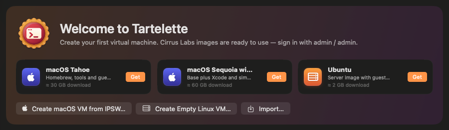
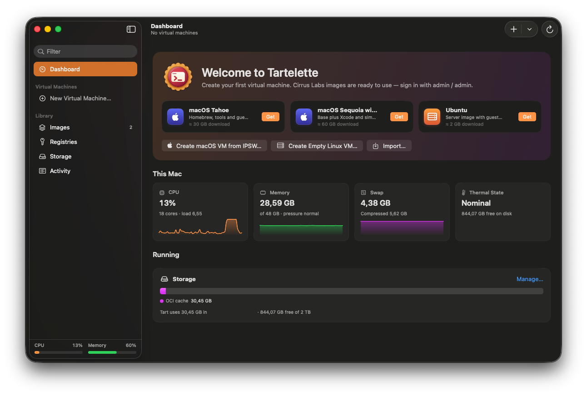
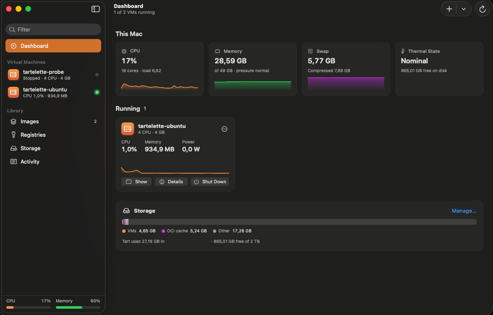
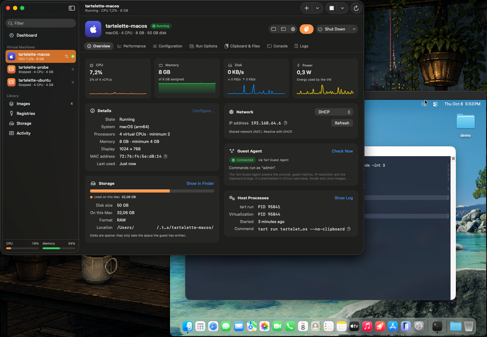
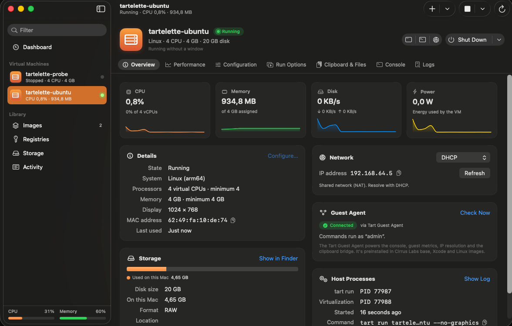
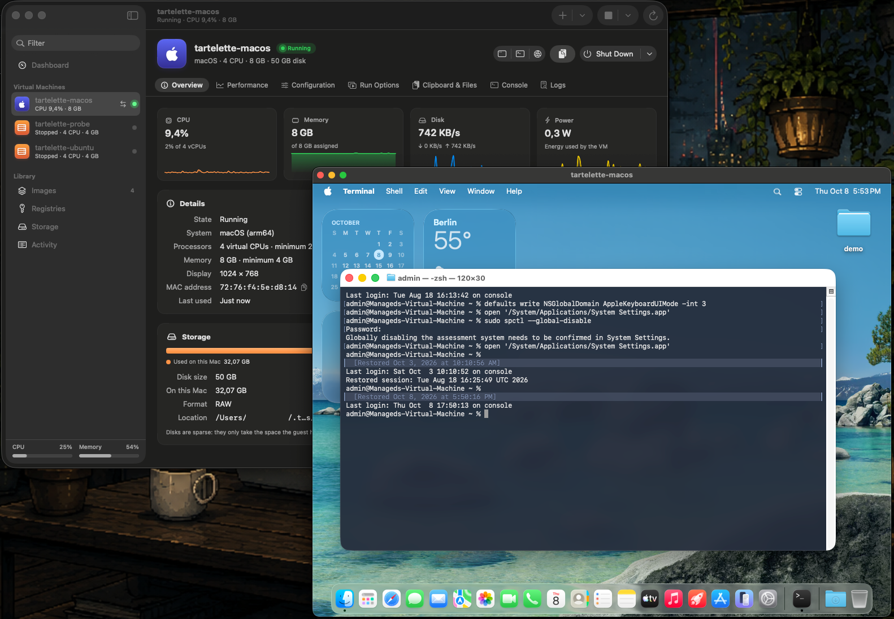

<p align="center">
  
</p>

# Tartelette

**Español** · [English](README.en.md)

[](https://github.com/lacrimae0rerum/tartelette/releases/latest)
[](https://github.com/lacrimae0rerum/tartelette/actions/workflows/ci.yml)

[](LICENSE)

Una app nativa de macOS para [Tart](https://tart.run): crea, arranca, configura, comparte y
vigila máquinas virtuales de Tart sin abrir la terminal, con métricas de rendimiento en vivo y
un portapapeles que funciona de verdad en los dos sentidos (texto, texto enriquecido, imágenes y
archivos).

Tartelette usa el ejecutable `tart` que ya tienes instalado (o el que instala ella misma si se lo
pides), así que todo lo que hace es exactamente lo que hace la línea de comandos. Cada hoja muestra el comando `tart …` equivalente,
listo para copiar.



## Requisitos

| | Requisito | Detalles |
|---|---|---|
| **Mac** | Apple silicon (M1 o posterior) | Los Mac con Intel no son compatibles: Tart solo funciona en Apple silicon y la app se distribuye solo para `arm64` (en un Mac con Intel, macOS indica que no es compatible con ese tipo de Mac). |
| **macOS** | macOS 14 Sonoma o posterior | Probado en macOS 26.7 (Tahoe) y en macOS 14.8 (Sonoma). En macOS 14, Tart no se puede instalar con Homebrew: instálalo desde Tartelette o desde su descarga oficial (ver [Instala Tart](#1-instala-tart)), y la red Softnet no está disponible. |
| **Tart** | 2.27 o posterior | El puente de portapapeles, la consola y las métricas del invitado usan `tart exec`, que llegó en Tart 2.27.0. Probado con Tart 2.40.1. |
| **Máquinas virtuales** | macOS y Linux (`arm64`) | Apple permite como máximo dos VM de macOS en marcha a la vez. |
| **Dentro de la VM** | Tart Guest Agent | Necesario para el portapapeles, la consola, las métricas del invitado y las herramientas de los [agentes de IA](#agentes-de-ia-mcp). Viene preinstalado en las imágenes de Cirrus Labs `*-base`, `*-xcode` y Linux. En macOS, el portapapeles necesita además una sesión de usuario iniciada; en Linux, un escritorio con `wl-clipboard` o `xclip`/`xsel`. |
| **Compilar** (opcional) | Xcode 26 o posterior | Solo si quieres compilarla tú: consulta [Compilar desde el código fuente](#compilar-desde-el-código-fuente). |

## Instalación

### 1. Instala Tart

**Lo más sencillo es dejar que Tartelette lo instale.** Si no tienes Tart, sigue con los pasos 2
y 3: al abrir Tartelette verás **Tart Isn't Installed** con el botón **Install Tart**. Tartelette
descarga la versión oficial de Tart desde GitHub (unos 23 MB), comprueba su SHA-256 y que está
firmada por el desarrollador de Tart (Cirrus Labs, equipo `9M2P8L4D89`), y la guarda sin
modificarla en `~/Library/Application Support/Tartelette/Tart`. No necesita Homebrew, así que
también sirve en macOS 14: instala la misma descarga oficial que la vía manual. Si algo falla, no
instala nada. Para actualizarlo, consulta
[Mantener Tart al día](#mantener-tart-al-día).

**Con [Homebrew](https://brew.sh)** (macOS 15 o posterior):

```bash
brew trust --formula openai/tools/tart openai/tools/softnet
brew install openai/tools/tart
```

Desde Homebrew 6, las fórmulas de repositorios de terceros hay que marcarlas como de confianza
antes de instalarlas, y Tart depende de Softnet, que está en el mismo repositorio. Con solo
`brew install openai/tools/tart` la instalación se detiene con «Refusing to load formula
openai/tools/softnet from untrusted tap».

Si ya tienes Tart de Homebrew, Tartelette lo sigue usando, y **Check for Updates** te muestra
`brew upgrade openai/tools/tart` cuando hay una versión nueva.

**A mano en macOS 14 Sonoma**: la fórmula de Homebrew no se puede instalar (Softnet necesita
macOS 15). Si prefieres no usar la instalación de Tartelette, instala Tart desde su descarga
oficial:

```bash
curl -fL https://github.com/openai/tart/releases/latest/download/tart.tar.gz | tar -xz -C /Applications
```

Tartelette lo encuentra en `/Applications/tart.app`. La pantalla **Tart Isn't Installed** también
muestra la alternativa para tu versión de macOS (Homebrew o la descarga oficial), con un botón
para ejecutarla en Terminal.

**Softnet** (para la red `--net-softnet`) no lo gestiona Tartelette: con Homebrew se instala junto
a Tart; si usas la copia de Tartelette, instálalo con `brew install openai/tools/softnet` (macOS 15
o posterior).

### 2. Descarga e instala Tartelette

1. Descarga **`Tartelette-1.0.0.dmg`** desde la [última versión](https://github.com/lacrimae0rerum/tartelette/releases/latest).
2. Ábrelo y arrastra **Tartelette** a la carpeta **Aplicaciones**. Ábrela siempre desde
   Aplicaciones, no desde la imagen de disco.

La versión incluye también `Tartelette-1.0.0.zip` (la misma app) y `SHA256SUMS.txt` para
[comprobar la descarga](#comprobar-la-descarga).

### 3. Ábrela por primera vez

Tartelette **no está notarizada por Apple**. Notarizar una app exige firmarla con un Developer ID
del Apple Developer Program (de pago); esta app se publica con una firma local («ad hoc») y con el
hardened runtime activado. Por eso, la primera vez que abres una copia descargada con el
navegador, macOS la bloquea. Es lo esperado y solo hay que hacerlo una vez:

1. Abre **Tartelette** desde Aplicaciones. macOS avisa de que no puede verificarla («Apple no ha
   podido verificar que Tartelette no contenga software malicioso…»; en macOS 14, que es de un
   desarrollador no identificado): cierra el aviso.
2. Ve a **Ajustes del Sistema › Privacidad y seguridad**, baja hasta la sección **Seguridad** y
   pulsa **Abrir igualmente** junto al mensaje sobre Tartelette. El botón aparece durante
   aproximadamente una hora después de intentar abrirla.
3. Confirma con **Abrir igualmente** y tu contraseña de inicio de sesión. A partir de ahí se abre
   con normalidad.

En macOS 14 también vale hacer clic en la app con la tecla Control pulsada y elegir **Abrir**.

Si macOS dice que la app **«está dañada»** y no te deja abrirla, o prefieres la terminal, quita la
marca de cuarentena que añade el navegador a lo descargado:

```bash
xattr -dr com.apple.quarantine /Applications/Tartelette.app
```

Haz también este paso si vas a usar [agentes de IA](#agentes-de-ia-mcp) con una copia descargada:
mientras `tartelette-mcp` lleve la marca, macOS lo cierra al lanzarlo. Hazlo solo con copias descargadas de este
repositorio, idealmente después de
[comprobar la descarga](#comprobar-la-descarga). Si prefieres evitar este paso, tienes dos
alternativas: [instalar desde la terminal](#instalar-desde-la-terminal) (lo que descarga `curl` no
lleva marca de cuarentena) o [compilarla tú](#compilar-desde-el-código-fuente) (lo que compilas en
tu Mac nunca la lleva).

### Instalar desde la terminal

```bash
cd ~/Downloads
curl -fLO https://github.com/lacrimae0rerum/tartelette/releases/download/v1.0.0/Tartelette-1.0.0.zip
curl -fLO https://github.com/lacrimae0rerum/tartelette/releases/download/v1.0.0/SHA256SUMS.txt
shasum -a 256 -c SHA256SUMS.txt --ignore-missing   # debe responder: Tartelette-1.0.0.zip: OK

# Si tienes una versión anterior, ciérrala antes: esto la sustituye.
rm -rf /Applications/Tartelette.app
ditto -x -k Tartelette-1.0.0.zip /Applications
open /Applications/Tartelette.app
```

### Comprobar la descarga

Descarga también `SHA256SUMS.txt` a la misma carpeta y ejecuta:

```bash
cd ~/Downloads && shasum -a 256 -c SHA256SUMS.txt --ignore-missing
```

Cada archivo descargado debe aparecer con `OK`.

### Actualizar

Descarga la versión nueva y sustituye la app en Aplicaciones (o repite
[la instalación desde la terminal](#instalar-desde-la-terminal) con la nueva versión). Los ajustes,
los perfiles de arranque y las contraseñas guardadas se conservan. Como cada versión descargada es
una copia nueva sin Developer ID, macOS vuelve a pedir el [paso del primer arranque](#3-ábrela-por-primera-vez)
y, si guardaste contraseñas en Tartelette, puede pedirte una vez permiso para que la nueva versión
las lea del llavero.

### Mantener Tart al día

Tartelette nunca busca versiones nuevas por su cuenta: pulsa **Check for Updates** en
**Settings › General › Tart** cuando quieras comprobarlo (si no lo pulsas, no sabrás que hay una
versión nueva). Actualizar Tart no requiere una versión nueva de Tartelette. Lo que te ofrece
depende de dónde viene el Tart que usa, según la fila **Source**:

| Source | Qué ofrece si hay una versión nueva |
|--------|-------------------------------------|
| **Managed by Tartelette** | **Update to X**: descarga y verifica la versión nueva y la instala junto a la anterior. Las VM en marcha siguen con la versión con la que arrancaron; los comandos nuevos usan la nueva. |
| **Homebrew** | El comando `brew upgrade openai/tools/tart`, con un botón para ejecutarlo en Terminal, o **Install Managed Copy** (**Use Managed Copy** si ya la tienes) para que Tartelette pase a usar su propia copia. |
| **Other** o **Chosen in Settings** | **Install Tart X**: instala la copia gestionada y pasa a usarla. |

Cuando Tartelette gestiona una copia, **Settings › General** muestra también la sección
**Managed Copy**:

- **Go Back to X** vuelve a la versión anterior, que Tartelette conserva. Las más antiguas solo
  las borra cuando ningún proceso las usa.
- **Remove Managed Copy…** borra la copia gestionada. Tus VM e imágenes no se tocan, y Tartelette
  pasa a usar otro Tart instalado, si lo hay. No se puede mientras una VM o un comando `tart` la
  esté usando.
- Para usar esa copia en tu propia terminal (por ejemplo, para pegar los comandos `tart …` que
  muestran las hojas), la sección muestra la línea que la pone primero en el `PATH`. Ejecútala o
  añádela a `~/.zshrc`:

  ```bash
  export PATH="$HOME/Library/Application Support/Tartelette/Tart/current/tart.app/Contents/MacOS:$PATH"
  ```

  Tartelette no necesita esa línea: **Open Terminal** y **Open SSH Session** ya ponen el Tart de
  la app primero en el `PATH` de la ventana que abren, y `tartelette-mcp` (ver
  [Agentes de IA](#agentes-de-ia-mcp)) usa el mismo Tart que la app.

El Tart que descarga Tartelette se distribuye con su propia licencia,
[FSL-1.1-ALv2](https://github.com/openai/tart/blob/main/LICENSE).

### Desinstalar

1. Si activaste **Open at login** (en **Settings › General**), desactívalo.
2. Cierra Tartelette y mueve `/Applications/Tartelette.app` a la papelera.
3. Opcional, para borrar también sus datos (incluida la copia de Tart que gestiona Tartelette, si
   la instalaste):

   ```bash
   rm -rf ~/Library/Application\ Support/Tartelette ~/Library/Caches/Tartelette ~/Library/Logs/Tartelette
   defaults delete io.github.lacrimae0rerum.Tartelette
   # Solo existen si guardaste contraseñas en Tartelette:
   security delete-generic-password -s io.github.lacrimae0rerum.Tartelette.ssh
   security delete-generic-password -s io.github.lacrimae0rerum.Tartelette.registry
   ```

Tus máquinas virtuales e imágenes están en `~/.tart` (o en `TART_HOME`): son de Tart y
desinstalar Tartelette no las toca.

## Primeros pasos

1. Abre **Tartelette**, pulsa **⌘N**, elige *macOS Tahoe* (o *Ubuntu*) y pulsa **Download & Create**.
2. Selecciona la VM y pulsa **⌘R**.
3. Copia algo en tu Mac: ya está en el portapapeles de la VM. La primera vez, macOS puede pedirte
   permiso para que Tartelette lea lo que copias (consulta [Permisos](#permisos-que-pide-macos)).

## Qué puedes hacer

| Área | En la app | Equivalente en Tart |
|------|-----------|---------------------|
| Crear | VM nueva desde una imagen de Cirrus Labs, desde un IPSW de macOS (el más reciente, un archivo o una URL), VM Linux vacía, importar un `.tvm` | `clone`, `create --from-ipsw`, `create --linux`, `import` |
| Arrancar | En una ventana, sin ventana, con VNC (Compartir Pantalla o el integrado), en modo Recuperación o con cualquier opción de arranque guardada | `run` y todas sus opciones |
| Controlar | Pedir el apagado (ordenado: a los invitados macOS se les pide a través del Tart Guest Agent, con `SIGUSR2` si no responde; a los Linux, con `SIGUSR2`), apagar, suspender, forzar la salida, mostrar la ventana de la VM | `exec`, `SIGUSR2`, `stop`, `suspend` |
| Configurar | CPU, memoria, pantalla (pt/px, ajuste automático), ampliar o sustituir el disco, nueva MAC o número de serie | `set` |
| Opciones de arranque | Red (compartida, puente, Softnet con allow/block/expose, solo host), carpetas compartidas, discos adicionales (imagen, VM en caché, NBD), caché y sincronización del disco raíz, Rosetta, virtualización anidada, consola serie, dispositivos de audio/USB/portapapeles/entrada, aprovisionamiento en el primer arranque | `run --net-* --dir --disk --root-disk-opts --rosetta --nested --serial …` |
| Acceder | Dirección IP (DHCP, ARP o agente del invitado), shell del invitado en Terminal, SSH, consola de comandos | `ip`, `exec -it`, `exec` |
| Compartir | Subir a registros (etiquetas, subida por partes, varios tags), descargar, exportar `.tvm`, clonar, renombrar, borrar | `push`, `pull`, `export`, `clone`, `rename`, `delete` |
| Registros | Iniciar y cerrar sesión; ver las credenciales del llavero, de la configuración de Docker y del entorno | `login --password-stdin`, `logout` |
| Almacenamiento | Uso de `TART_HOME`, espacio asignado por VM, desglose de la caché, limpieza por antigüedad, por tamaño máximo o GC | `prune` |
| Monitorizar | Del Mac: CPU, memoria, presión de memoria, swap y estado térmico. Por VM: CPU (invitado frente a Tart), memoria, E/S de disco y consumo. Del invitado: CPU, carga, memoria, disco y tiempo encendido | — |
| Agentes de IA | Deja que los agentes de tu Mac (Claude Code, Codex, Cursor…) usen las VM que compartas: arrancarlas, ejecutar comandos, copiar archivos y clonar VM desechables. Consulta [Agentes de IA](#agentes-de-ia-mcp) | — |

Y además: icono en la barra de menús con el estado de las VM en vivo, globo en el Dock con las VM
en marcha, menú del Dock, progreso de las descargas en el Dock, notificaciones cuando termina una
tarea larga y atajos de teclado para cada acción. El menú **Help** enlaza con este repositorio,
las notas de versión y la página para informar de problemas.

## Capturas

**Panel** — CPU, memoria, swap y estado térmico de este Mac, cada VM en marcha con su CPU,
memoria y consumo en vivo, y cuánto espacio ocupan las VM y las cachés de Tart.



**Una VM de macOS en marcha** — CPU, memoria, disco y consumo en vivo, el estado del agente del
invitado y, detrás, la ventana de la propia VM.



**Resumen de una VM** — una VM de Ubuntu sin ventana: indicadores en vivo, su configuración, la
dirección IP (resuelta por DHCP, ARP o el agente del invitado), el estado del agente y los
procesos del Mac que la mueven (`tart run` y el servicio de virtualización), con el comando
exacto con el que se arrancó.



**Trabajando dentro de la VM** — el macOS invitado en la ventana de Tart junto a Tartelette. Con
la sincronización en vivo activada (el botón naranja del portapapeles), lo que copias en un lado
está listo para pegar en el otro.



## Copiar y pegar entre el Mac y la VM

El portapapeles compartido que trae Tart (SPICE) solo copia texto, y en los invitados macOS el
agente puede sustituir el contenido enriquecido de tu Mac por texto sin formato. Tartelette añade
su propio **puente de portapapeles**:

| | Tartelette Bridge | Tart (SPICE) |
|---|---|---|
| Contenido | Texto, RTF, HTML, imágenes PNG/TIFF, archivos y carpetas | Texto sin formato |
| Sentido | Los dos, en vivo (o en un solo sentido, o manual) | Los dos |
| Necesita | Tart Guest Agent (imágenes `*-base`, `*-xcode` y Linux de Cirrus Labs) | Agente del invitado o `spice-vdagent` |

Cómo funciona: Tartelette vigila el portapapeles de tu Mac y consulta el de la VM mediante
`tart exec`, mueve cada contenido con una comprobación SHA-256 (si una transferencia llega
corrupta, la repite en bloques verificados de 128 KiB; consulta tart#1347) y recuerda lo que ha
escrito en cada lado para que nada vuelva de rebote. Los archivos copiados se preparan en la VM y
se colocan en su portapapeles, así que **⌘V en el Finder los pega**. También puedes soltar
archivos sobre una VM para copiarlos a su escritorio.

Elige el mecanismo para cada VM en **Run Options › Clipboard & Address** (o con **Change…** en la
pestaña **Clipboard & Files**): *Automatic* (el puente para invitados macOS y SPICE para Linux),
*Tartelette Bridge*, *Tart (SPICE)* u *Off*. Con el puente, las VM arrancan con `--no-clipboard`
para que los dos mecanismos nunca choquen. La sincronización en vivo se activa sola al arrancar
una VM; puedes cambiarlo en **Settings › Clipboard › Turn on live sync when a VM starts**.

Los invitados Linux necesitan una sesión de escritorio y `wl-clipboard` o `xclip`/`xsel`. Las
imágenes de servidor de Cirrus Labs no tienen escritorio, así que ahí el puente indica que el
portapapeles no está disponible (la transferencia de archivos, la consola y las métricas siguen
funcionando).

**Permiso de macOS para leer el portapapeles.** Desde macOS 15.4, macOS puede preguntar (o
negarse) antes de que una app lea lo que copias en otras apps. La sincronización en vivo lee el
portapapeles del Mac cada vez que copias algo, así que permite Tartelette en **Ajustes del
Sistema › Privacidad y seguridad › Pegar desde otras apps**. Si macOS está configurado para
preguntar o denegar, la pestaña **Clipboard & Files** de la VM lo avisa y ofrece el botón
**Open Settings…**, que abre ese ajuste.

Conviene saber:

- Un cambio se sincroniza cuando se ha asentado: los portapapeles a medio escribir (una app que
  aún está añadiendo elementos) y los archivos que su app todavía no ha entregado se reintentan en
  lugar de enviarse a medias.
- Durante los 10 segundos posteriores a una sincronización, copiar *parte* de los archivos recién
  sincronizados se considera un rebote y no se devuelve. Si lo hacías a propósito, vuelve a
  copiarlos pasado ese tiempo.
- Solo funciona una copia de Tartelette a la vez: si abres una segunda, se cierra y trae al frente
  la primera, para que nunca haya dos copias sincronizando la misma VM entre sí.

## Agentes de IA (MCP)

Tartelette incluye `tartelette-mcp`, un servidor [MCP](https://modelcontextprotocol.io) con el que
los agentes de IA de tu Mac (Claude Code, Codex, Cursor…) pueden usar las VM que compartas con
ellos: arrancarlas, ejecutar comandos dentro, copiar archivos y clonar VM desechables para trabajar.
El agente lanza el servidor por su cuenta y se comunica con él por la entrada y la salida estándar:
no escucha en ningún puerto de red y funciona aunque Tartelette esté cerrada.

Está **desactivado por defecto**, y ninguna VM se comparte hasta que tú lo decides, una por una.

Si quieres que tu agente lo configure por su cuenta, indícale [`docs/AGENT_SETUP.md`](docs/AGENT_SETUP.md):
comprueba los requisitos, añade Tartelette y te pide los pasos que solo puedes dar tú.

### Activarlo

1. En **Settings › Agents**, activa **Let AI agents use Tartelette's VMs**.
2. En la pestaña **Configuration** de cada VM que quieras compartir, elige su nivel en **Agent
   Access** (los niveles se explican en la sección siguiente).
3. Añade Tartelette a tu agente. **Settings › Agents** muestra lo mismo, con botones para copiarlo.

   En Claude Code:

   ```bash
   claude mcp add tartelette -- /Applications/Tartelette.app/Contents/MacOS/tartelette-mcp
   ```

   En otros clientes MCP:

   ```json
   {
     "mcpServers": {
       "tartelette": {
         "command": "/Applications/Tartelette.app/Contents/MacOS/tartelette-mcp"
       }
     }
   }
   ```

**Si descargaste Tartelette con el navegador**, quita también la marca de cuarentena de todo el
paquete. Mientras `tartelette-mcp` lleve esa marca, macOS lo cierra en cuanto el agente lo lanza, y el
agente indica que el servidor no ha podido arrancar.

```bash
xattr -dr com.apple.quarantine /Applications/Tartelette.app
```

Lo que [instalas desde la terminal](#instalar-desde-la-terminal) o
[compilas tú](#compilar-desde-el-código-fuente) no lleva esa marca.

Si mueves Tartelette a otra carpeta, vuelve a configurarlo en tu agente. `tartelette-mcp --version`
y `tartelette-mcp --help` también funcionan desde Terminal.

### Qué puede hacer un agente

| Acceso | El agente puede |
|--------|-----------------|
| **None** (por defecto) | Nada: la VM no aparece en su lista |
| **Read** | Ver la VM y su configuración |
| **Operate** | Verla, arrancarla y apagarla, ejecutar comandos en ella y copiar archivos dentro y fuera |
| **Template** | Verla y clonar a partir de ella VM desechables, que el agente controla por completo (también puede borrarlas) |

Los agentes solo pueden borrar las VM que han creado ellos; si más tarde se crea otra VM con el mismo
nombre, no se considera suya. Cuando algo no está permitido (los agentes están desactivados, la VM no
está compartida, la VM no es suya…), el agente recibe un mensaje que lo explica. Tartelette no ofrece,
a propósito, el sentido contrario: un agente que se ejecuta dentro de una VM no puede controlar el Mac.

### Herramientas y límites

| Herramienta | Qué hace |
|-------------|----------|
| `list_vms` | Lista las VM compartidas, con su estado y su nivel de acceso |
| `vm_info` | Muestra el estado y la configuración de una VM |
| `start_vm` | Arranca una VM sin ventana y, si se le pide, espera a que responda el Tart Guest Agent |
| `stop_vm` | Pide al invitado que se apague y, si no lo hace a tiempo, la apaga; con `force`, la apaga en el acto |
| `create_sandbox` | Clona una VM **Template** parada (si no se indica un nombre, genera uno) y puede arrancarla |
| `delete_vm` | Borra una VM creada por un agente |
| `exec` | Ejecuta un comando en un login shell del invitado, con entrada estándar opcional y tiempo límite |
| `read_file` | Lee un archivo del invitado por páginas, como texto o en base64 |
| `write_file` | Escribe un archivo (texto o base64), crea las carpetas que falten y lo comprueba con SHA-256 |

| Límite | Valor por defecto |
|--------|-------------------|
| Tiempo límite de `exec` | 120 s (hasta 1800 s) |
| Salida | 256 KiB para la salida estándar y otros 256 KiB para la de error en `exec`; 256 KiB por página en `read_file` |
| Archivos que escribe `write_file` | Hasta 50 MiB |
| VM creadas por agentes | 4 como máximo |
| VM de macOS en marcha | 2 (el límite de Apple) |

Los agentes llegan al invitado solo a través del Tart Guest Agent, preinstalado en las imágenes de
Cirrus Labs (también en las de Linux); no usan SSH.

**Limitación conocida.** Se rechazan los argumentos que empiezan por `data:` y contienen una coma (por
ejemplo, un archivo cuyo contenido empieza así), porque el SDK de MCP los alteraría. Envía ese
contenido en base64.

Probado con Claude Code en macOS 26.7 y Tart 2.40.1, con la imagen Ubuntu 24.04 de Cirrus Labs:
listar las VM, clonar una VM desechable de una VM **Template**, arrancarla (el agente del invitado
respondió en unos 5 segundos), ejecutar comandos, escribir y leer archivos, y apagarla y borrarla.

### Registro y ajustes

- **Registro.** Cada llamada queda registrada (hora, cliente del agente, herramienta, VM y resultado)
  en `~/Library/Logs/Tartelette/agents.log`. **Settings › Agents** muestra las 50 más recientes y abre
  el registro con **Show Log in Finder**. La entrada estándar de los comandos y el contenido de los
  archivos nunca se registran.
- **Ajustes.** Se guardan en `~/Library/Application Support/Tartelette/agents.json` y se aplican de
  inmediato: los agentes ven cada cambio en su siguiente llamada.
- **Archivo dañado.** Si `agents.json` está dañado, Tartelette nunca lo sobrescribe sin avisar, y
  mientras tanto los agentes no pueden usar ninguna VM. **Settings › Agents** ofrece restablecerlo con **Reset Agent Settings…**,
  que desactiva los agentes y deja de compartir todas las VM.

## Permisos que pide macOS

| Cuándo | Qué pide macOS | Qué hacer |
|--------|----------------|-----------|
| La primera vez que abres una copia descargada | La bloquea Gatekeeper (la app no está notarizada) | [Ábrela por primera vez](#3-ábrela-por-primera-vez) |
| Al sincronizar el portapapeles en vivo (macOS 15.4 o posterior) | Permiso para leer lo que copias en otras apps | **Ajustes del Sistema › Privacidad y seguridad › Pegar desde otras apps** → permite Tartelette |
| La primera vez que lanzas una tarea larga (crear, clonar, descargar o subir una VM…) | Permiso para enviar notificaciones (avisan cuando termina) | Opcional; se desactiva en **Settings › General › Notify when long operations finish** |
| Al activar Softnet | Contraseña de administrador, una sola vez | **Settings › Registries & Network › Allow Softnet to Run…** |
| Después de actualizar, si guardaste contraseñas | Puede pedir acceso al llavero | Permítelo para que la nueva versión lea sus contraseñas |

## Privacidad

- **Solo se conecta a internet cuando se lo pides.** Tartelette solo se conecta a GitHub
  (`api.github.com` y la descarga de la versión de Tart) cuando pulsas **Check for Updates**,
  **Install** o **Update**. No hay telemetría, analítica ni comprobaciones automáticas de
  actualizaciones. El resto del tráfico de red lo genera `tart` (al descargar, subir o iniciar
  sesión en registros), `ssh` hacia tus VM cuando usas ese respaldo, y los enlaces que abres en
  el navegador.
- **El portapapeles no sale de tu Mac.** Va entre el Mac y tus VM locales mediante `tart exec`
  (o SSH). Las transferencias se preparan en `~/Library/Caches/Tartelette/Clipboard`.
- **Contraseñas.** La contraseña de **Registries › Log In** se le pasa a `tart login
  --password-stdin` por la entrada estándar y Tartelette no la guarda (la guarda Tart). La
  contraseña de respaldo para SSH y las credenciales opcionales de **Settings › Registries &
  Network** se guardan en el llavero de macOS; llegan a `ssh` a través de un asistente askpass y
  a `tart` como variables `TART_REGISTRY_*`, nunca como argumentos de la línea de comandos.
- **Agentes de IA, solo si los activas.** `tartelette-mcp` se comunica con el agente que lo lanza
  solo por la entrada y la salida estándar y no escucha en ningún puerto de red (incluye el SDK de
  MCP, que trae transportes de red que no usa). El registro de llamadas nunca guarda la entrada
  estándar de los comandos ni el contenido de los archivos.
- **Sin sandbox, a propósito.** La app tiene que ejecutar `tart`, leer `~/.tart` e inspeccionar
  los procesos de las VM para medir su consumo, cosas que el sandbox de macOS no permite.

## Compilar desde el código fuente

Necesitas un Mac con Apple silicon y **Xcode 26 o posterior** (probado con Xcode 27.0), que a su
vez necesita macOS 15.6 o posterior ([requisitos de Xcode](https://developer.apple.com/xcode/system-requirements/)).
La app compilada funciona desde macOS 14. El proyecto usa ajustes de compilación que llegaron con Xcode 26 (aislamiento
`MainActor` por defecto y *approachable concurrency*) y un icono de Icon Composer (`.icon`), así
que las versiones anteriores de Xcode no pueden compilarlo. La integración continua compila la app y
pasa todos los tests con Xcode 26.0.1 y 26.6. La app no tiene dependencias de terceros; el servidor
`tartelette-mcp` usa el [SDK de MCP para Swift](https://github.com/modelcontextprotocol/swift-sdk) y
[swift-log](https://github.com/apple/swift-log).

`xcodebuild` necesita Xcode completo (no basta con las Command Line Tools). Si `make` se queja,
selecciónalo:

```bash
sudo xcode-select -s /Applications/Xcode.app
```

```bash
git clone https://github.com/lacrimae0rerum/tartelette.git
cd tartelette
make test       # tests de TarteletteKit y de la app
make run        # compila la versión Release en build.noindex/Tartelette.app y la abre
make install    # la copia a /Applications (cambia la carpeta con INSTALL_DIR=…)
```

| Comando | Qué hace |
|---------|----------|
| `make test` | Ejecuta los tests de TarteletteKit (Swift Testing) y los de la app |
| `make build` | Compila la versión Release, con `tartelette-mcp` dentro, en `build.noindex/Tartelette.app` (el sufijo `.noindex` evita que Spotlight la muestre junto a la app instalada) |
| `make run` | Compila y abre la app |
| `make install` | Compila y la instala en `/Applications` sustituyendo la anterior de forma atómica (`INSTALL_DIR=…` para otra carpeta) |
| `make uninstall` | Borra la app instalada |
| `make package` | Genera `dist/Tartelette-<versión>.dmg`, `.zip` y `SHA256SUMS.txt` a partir de la versión Release |
| `make release` | Todo lo necesario para publicar, en orden: `check-assets`, `test` y `package` |
| `make assets` | Regenera el icono de la app, los iconos de la barra de menús y el logotipo |
| `make check-assets` | Comprueba que los recursos de marca guardados coinciden con su generador |
| `make open` | Abre el proyecto en Xcode |
| `make clean` | Borra `build.noindex/`, `dist/` y la caché de compilación del paquete |

Lo que compilas en tu Mac se firma de forma local («ad hoc») para `arm64` y no lleva marca de
cuarentena, así que se abre sin el paso de Gatekeeper.

## Cómo está hecha

```
Tartelette.xcodeproj        targets de la app y de tartelette-mcp (carpeta sincronizada, dependencia de paquete local)
Tartelette/                 app SwiftUI: App/, Stores/, Features/, Components/, Support/
TarteletteTests/            tests de la app
TarteletteKit/              paquete Swift; solo el servidor MCP tiene dependencias de terceros
  TarteletteCore            dominio: modelos de VM, comandos de tart tipados, parsers, puertos
  TarteletteCLI             adaptador: ejecuta tart, transmite el progreso, arranca VM, llavero, Softnet
  TarteletteMetrics         adaptador: métricas del Mac y de cada VM, uso del almacenamiento
  TarteletteGuest           adaptador: transportes tart exec/SSH, puente de portapapeles, métricas del invitado
  TarteletteInstall         adaptador: busca, descarga, verifica e instala el Tart que gestiona la app (solo la app)
  TarteletteAgents          acceso de los agentes: permisos por VM, VM que crean, autorización, registro, herramientas
  TarteletteMCP             servidor MCP: expone las herramientas de los agentes (SDK de MCP para Swift)
  TarteletteMCPServer       el ejecutable tartelette-mcp, que los agentes lanzan por stdio
Tools/BrandKit              icono Liquid Glass de la app e iconos de la barra de menús dibujados por código
```

| Tema | Decisión |
|------|----------|
| Fuente de verdad | El binario `tart`. El refresco usa `tart list --format json` y el `config.json` de cada VM, nunca `tart get` (cambia las fechas de acceso que usa `prune`). |
| VM en marcha | `tart run` se lanza en su propia sesión y escribe su salida en `~/Library/Logs/Tartelette/<vm>.log`, así que las VM siguen en marcha si cierras la app. El PID se obtiene del bloqueo `fcntl` de Tart sobre `config.json`, de modo que las VM arrancadas desde la terminal se controlan igual. |
| Progreso | Tart se ejecuta con `CI=1` (líneas `N%` simples) y con un `PATH` que incluye Homebrew, para que encuentre Softnet y los asistentes de credenciales de Docker. Cancelar envía `SIGINT`, con lo que Tart limpia lo que deja a medias. |
| Métricas por VM | Cada VM se ejecuta en un proceso XPC `com.apple.Virtualization.VirtualMachine`, que se asocia a su VM por los archivos de disco y NVRAM que tiene abiertos. El tiempo de CPU de `proc_pid_rusage` se convierte desde ticks de Mach; el consumo sale del contador de energía del kernel. |
| Secretos | La contraseña de **Registries › Log In** llega a Tart solo por la entrada estándar y Tartelette no la guarda. Las contraseñas de respaldo para SSH viven en el llavero y llegan a `ssh` mediante un asistente askpass, nunca por argumentos. |

## Solución de problemas

| Síntoma | Solución |
|---------|----------|
| macOS no deja abrir Tartelette o dice que «está dañada» | La app no está notarizada: sigue [Ábrela por primera vez](#3-ábrela-por-primera-vez) o quita la cuarentena con `xattr -dr com.apple.quarantine /Applications/Tartelette.app`. |
| El agente de IA dice que el servidor `tartelette-mcp` no ha podido arrancar | En una copia descargada con el navegador, macOS lo bloquea por la marca de cuarentena: quítala de todo el paquete con `xattr -dr com.apple.quarantine /Applications/Tartelette.app`. Si has movido Tartelette, vuelve a configurarlo en el agente (ver [Agentes de IA](#agentes-de-ia-mcp)). |
| macOS indica que la app no es compatible con este tipo de Mac | Es un Mac con Intel. Tart y Tartelette solo funcionan en Apple silicon. |
| macOS pregunta cada vez que copias algo, o no llega nada del Mac a la VM | Permite Tartelette en **Ajustes del Sistema › Privacidad y seguridad › Pegar desde otras apps** (el botón **Open Settings…** de la pestaña **Clipboard & Files** lleva ahí). |
| «Tart isn't installed» | Pulsa **Install Tart** (ver [Instala Tart](#1-instala-tart)) o elige su ejecutable con **Locate tart…** o en **Settings › General**. |
| `brew install openai/tools/tart` dice «Refusing to load formula … from untrusted tap» | Homebrew 6 o posterior: ejecuta antes `brew trust --formula openai/tools/tart openai/tools/softnet`. |
| Homebrew dice «softnet: This formula does not run on macOS versions older than Sequoia» | Estás en macOS 14: deja que Tartelette instale Tart o instálalo desde su [descarga oficial](#1-instala-tart). |
| «This copy of Tart failed the signature check…» | Tartelette no usa esa copia y no ha cambiado nada: Tart tiene que estar firmado por su desarrollador, Cirrus Labs (equipo `9M2P8L4D89`), y sin modificar. Vuelve a intentarlo más tarde; instalar Tart de nuevo también sustituye una copia dañada. |
| «Tartelette couldn't reach GitHub…», «…couldn't download Tart from GitHub» o «GitHub limits how often…» | No hay conexión o se ha alcanzado el límite de consultas de GitHub sin cuenta. No se ha instalado nada: comprueba la conexión y vuelve a intentarlo (si es el límite, cuando indique el mensaje). |
| «Tartelette is already installing or changing Tart…» | Hay otra operación de Tartelette con Tart en marcha (instalar, actualizar, volver atrás o quitar la copia). Espera a que termine y vuelve a intentarlo. |
| El portapapeles dice que el agente del invitado no está disponible | Usa una imagen `*-base`/`*-xcode` o instala `tart-guest-agent` en el invitado, y comprueba que hay una sesión de usuario iniciada. |
| El agente de IA dice que el agente del invitado de la VM no responde | Las herramientas de los agentes llegan al invitado solo mediante el Tart Guest Agent (no por SSH): usa una imagen de Cirrus Labs o instala `tart-guest-agent` en el invitado. Si la VM acaba de arrancar, espera unos segundos (`start_vm` puede esperar a que responda). |
| La red Softnet falla | **Settings › Registries & Network › Allow Softnet to Run…** (pide la contraseña de administrador una vez). |
| Una tercera VM de macOS no arranca | Apple permite dos invitados macOS a la vez. |
| Las funciones de exec o del agente fallan con un Tart compilado por ti | Las compilaciones desde el código fuente se identifican como `SNAPSHOT`, versión que el agente de macOS rechaza; usa una versión publicada de Tart. |

¿Algo más? [Abre una incidencia](https://github.com/lacrimae0rerum/tartelette/issues) (o usa
**Help › Report an Issue…** en la app).

## Licencia

Tartelette se distribuye con la [licencia MIT](LICENSE). Tart es un proyecto independiente con su
propia licencia, [FSL-1.1-ALv2](https://github.com/openai/tart/blob/main/LICENSE); Tartelette no
contiene código de Tart y usa el `tart` que tengas instalado o el que descarga de GitHub cuando se
lo pides.
